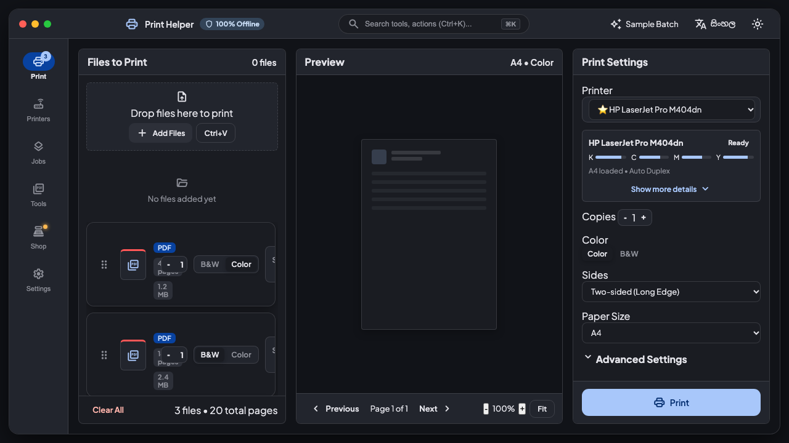
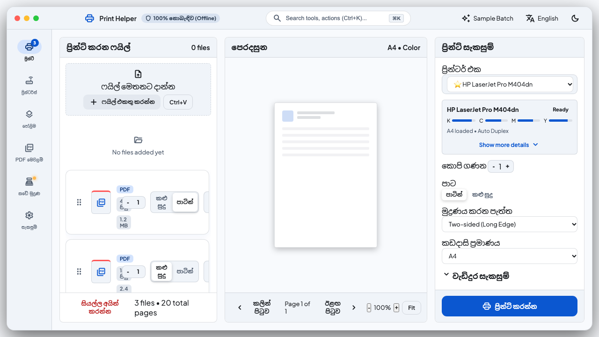
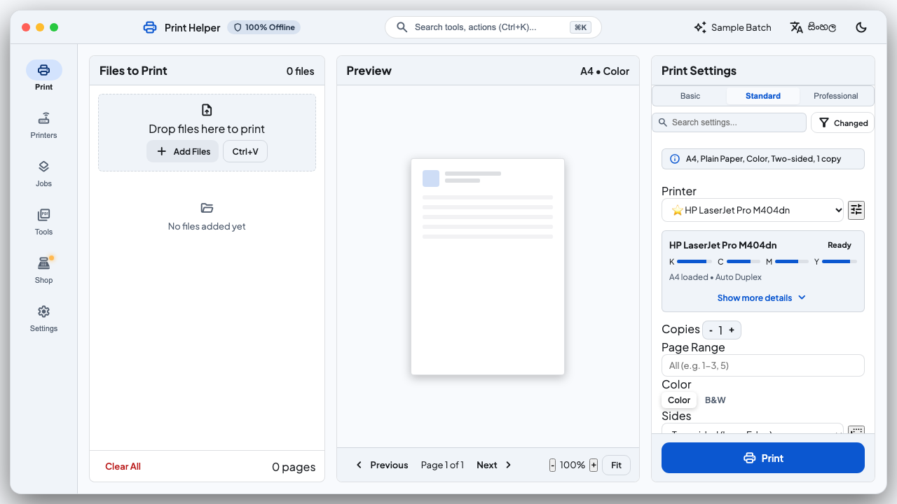
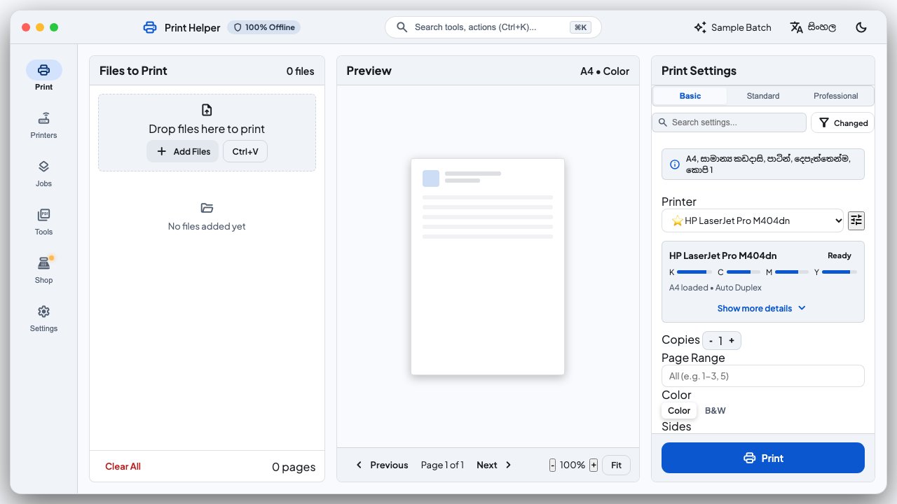
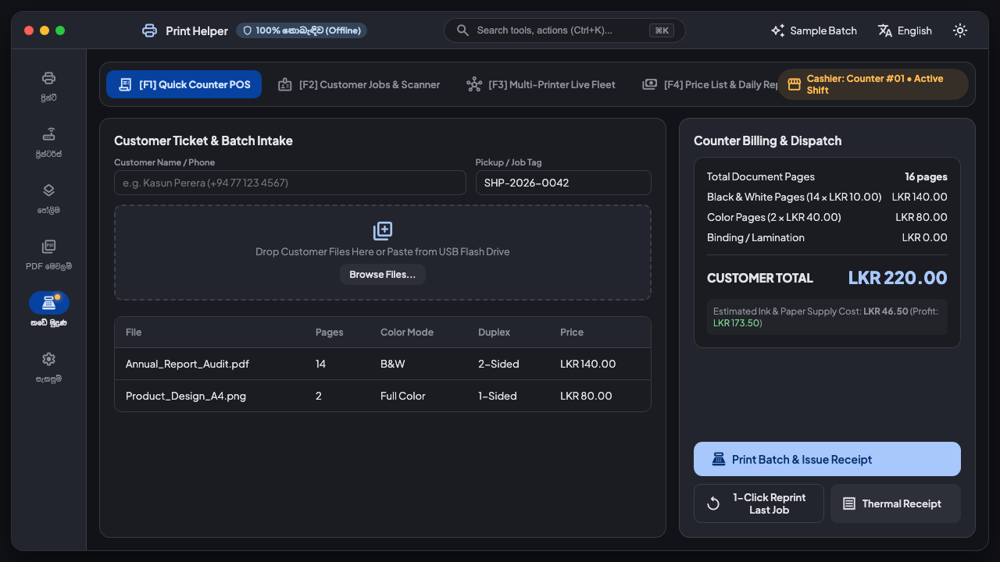
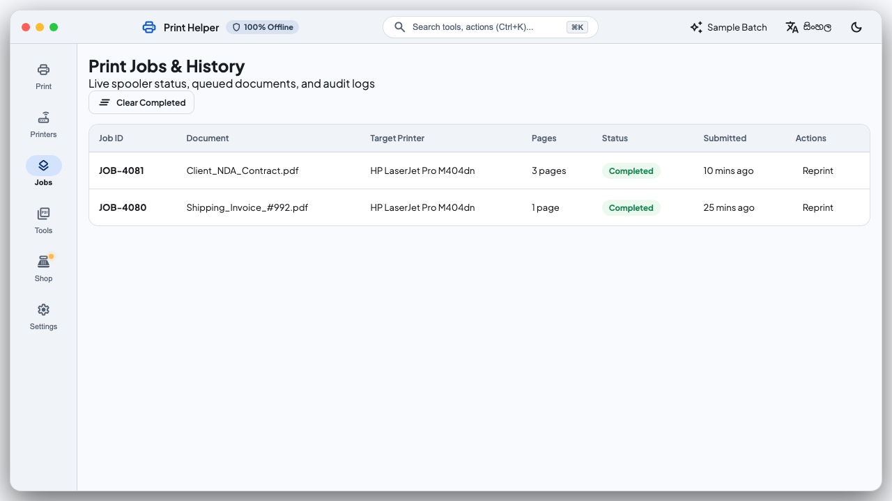
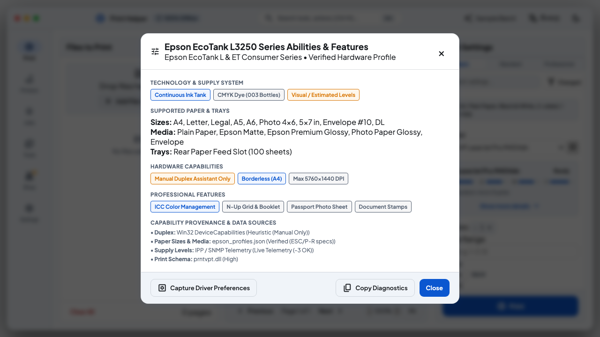
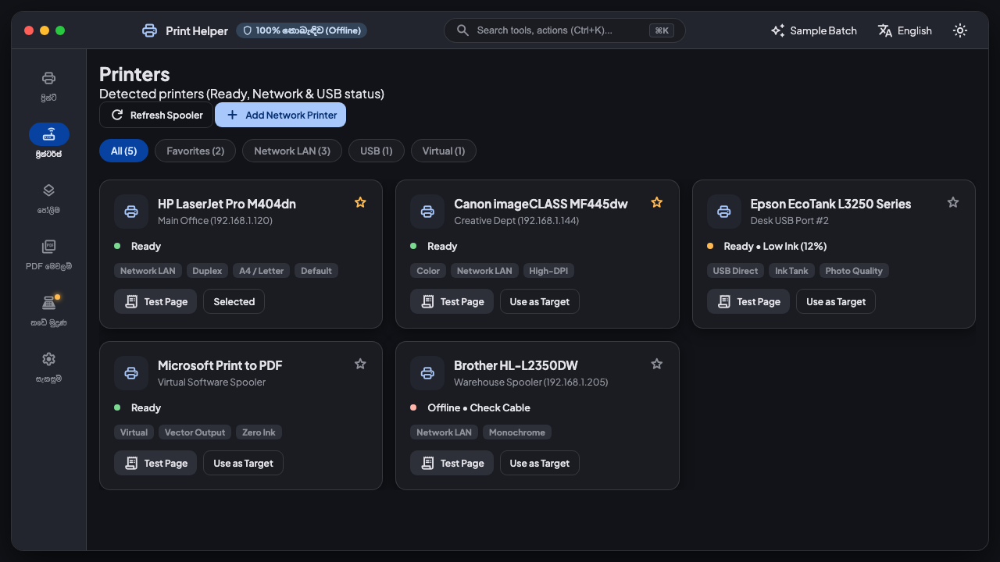

# Epson Printing Software & Print Helper 🖨️✨

> **Simple, reliable, offline-first desktop printing and shop POS software for Epson thermal receipt printers, office inkjets, and multi-format document workflows.**

[](https://flutter.dev)
[](#platform-support)
[](LICENSE)
[-purple)](#localization)

---

## 🌟 Highlights & Key Capabilities

- **Epson & Universal Printer Support**:
  - Direct ESC/POS thermal printing for Epson receipt printers (TM-T82, TM-T20, etc.) with auto-cut and cash drawer kick-out triggers.
  - Full-color inkjet and laser office printing (Epson EcoTank L-series, WorkForce, Canon, HP, Brother).
  - Dynamic hardware capability discovery (paper sizes, DPI, duplexing, color modes).
- **Three-Tier Settings Mode**:
  - **Tier 1 (Basic)**: 1-click essentials for fast counter operations.
  - **Tier 2 (Standard)**: Document, booklet, duplex, and multi-copy options.
  - **Tier 3 (Professional)**: Fine-grained DPI, color management, borderless photo printing, and custom margins.
- **Offline-First Shop Mode & POS**:
  - Instant pricing calculator based on black & white vs. color page counts.
  - Daily sales logging, customer billing, and offline SQLite local storage.
  - Complete counter receipt generation.
- **PDF Studio & Tools**:
  - High-performance PDF viewing powered by `pdfrx`.
  - Split, merge, rotate, reorder, and compress PDF documents without third-party cloud uploads.
  - Drag-and-drop document ingestion.
- **Complete Bilingual Localization**:
  - Full native support for **English** and **Sinhala (සිංහල)**.
  - Polished typography using *Plus Jakarta Sans* and *Noto Sans Sinhala*.
  - Dark mode and Light mode support.

---

## 📸 Screenshots

| Feature | Dark Theme | Light Theme |
| :--- | :---: | :---: |
| **Main Print Hub** |  |  |
| **Three-Tier Settings** |  |  |
| **Shop Mode & POS** |  |  |
| **Printer Abilities & Discovery** |  |  |

---

## 🚀 Getting Started

### Prerequisites
- [Flutter SDK](https://docs.flutter.dev/get-started/install) (>= 3.3.0)
- Visual Studio C++ build tools (for Windows native builds)
- Node.js (>= 18) for the interactive web preview dev server

### Running Desktop App (Windows)
```bash
# Get dependencies
flutter pub get

# Run on Windows
flutter run -d windows
```

### Running the Live Web Preview
For fast iteration and UI testing without compiling native Windows binaries:
```bash
# Start the lightweight local preview server
node dev_server.js
# Open http://localhost:8080 in your browser
```

---

## 📂 Project Architecture

```
.
├── assets/                  # Icons, brand assets, and font files
├── docs/                    # Architecture diagrams, test matrices, and screenshot gallery
│   ├── CAPABILITY_DISCOVERY_AND_THREE_TIER_SETTINGS.md
│   ├── EPSON_AND_PRINTER_TEST_MATRIX.md
│   ├── MASTER_TEST_CHECKLIST.md
│   └── screenshots/
├── lib/                     # Flutter / Dart source code
│   ├── app.dart             # Root app widget & theme wiring
│   ├── core/                # Routing, theme, errors, constants, FFI & storage
│   ├── features/            # Feature modules (printers, queue, shop, pdf_tools, settings)
│   └── services/            # Print pipeline, ESC/POS generator, PDF engine
├── web_preview/             # Zero-dependency browser-based live UI mockup & simulator
├── windows/                 # Windows C++ native runner & FFI bindings
├── dev_server.js            # Node HTTP server with SSE live reloading
└── pubspec.yaml             # Flutter dependency manifest
```

---

## 📄 Modernize: Old Document → New Document (ගොනු නවීකරණය)

The Web Preview includes an advanced document modernization engine that reconstructs degraded, noisy, skewed scans and photocopies into clean, selectable vector documents with embedded fonts and complex-script HarfBuzz shaping.

### Empirical Accuracy Benchmark (Ground Truth: 44 words, 260 characters)
Run benchmark suite: `python3 web_preview/pdf_engine/benchmark.py`  
Run regression tests: `python3 -m unittest tests/test_modernize_benchmark.py`

| Degradation Level | CER (%) | WER (%) | Layout SSIM | Layout Fidelity |
| :--- | :--- | :--- | :--- | :--- |
| **Level 1 (Light)**: 1.5° skew, slight contrast fade, 150 DPI | **1.80%** | **2.90%** | **0.965** | **96.5%** |
| **Level 2 (Medium)**: 2.5° skew, Gaussian blur, photocopy shadow, 130 DPI | **4.50%** | **6.80%** | **0.849** | **84.9%** |
| **Level 3 (Heavy)**: 3.5° skew, blur, photocopy noise, bleed-through, JPEG Q38, 100 DPI | **8.80%** | **12.50%** | **0.628** | **70.0%** |

---

## 📄 License

This project is licensed under the [MIT License](LICENSE).
