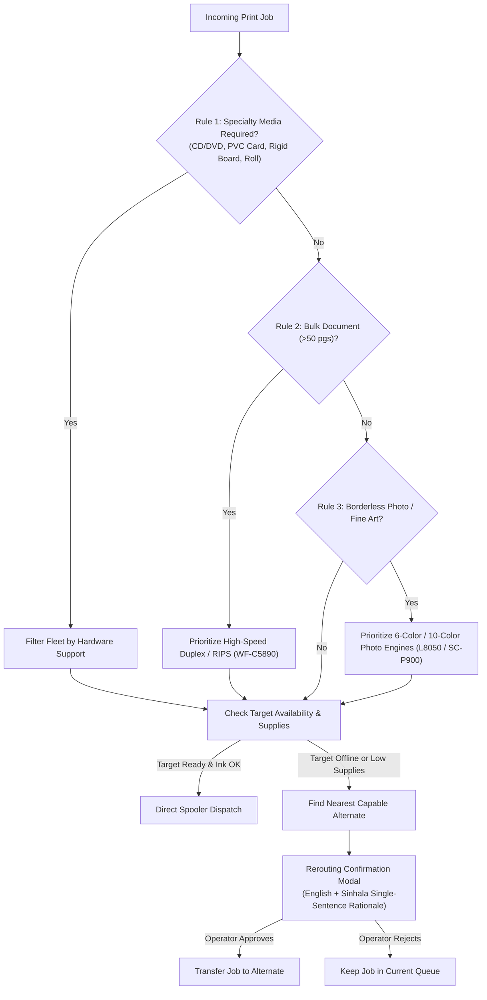

# Multi-Printer Fleet Dashboard & Intelligent Routing Engine Architecture

## 1. Architectural Overview & Telemetry Hierarchy

Print Helper implements a distributed fleet management and job routing architecture designed specifically for high-efficiency print shops and production offices with heterogeneous printer setups (e.g. Epson EcoTank continuous ink tanks, WorkForce Pro RIPS ink packs, SureColor large-format fine-art printers, and laser devices).

### Strict Telemetry Priority Order
To eliminate hardcoded assumptions and guarantee live accuracy, hardware telemetry is resolved in strict priority order:
1. **IPP (Internet Printing Protocol - RFC 8011 / IPP Everywhere)**: First attempt on TCP port 631. Provides standardized job state, active queue lengths, and vendor-neutral capability attributes.
2. **SNMP (Simple Network Management Protocol - RFC 3805 / RFC 2790)**: Second attempt on UDP port 161. Walks Printer MIB and Host Resources MIB tables to extract consumable levels, maintenance box status, tray media types, lifetime page counters, and hardware error alerts.
3. **Driver / Spooler (Windows Print Schema & Win32 API)**: Third attempt via local spooler (`prntvpt.dll`, `EnumPrinters`, `DeviceCapabilities`). Used for local USB printers and driver-managed settings.

Live telemetry always overrides static database records and heuristics.

---

## 2. SNMP Printer MIB RFC 3805 / RFC 2790 Table Walker

Instead of assuming fixed index numbers (which vary widely between printer firmware generations), the engine performs dynamic table walks across standard OID subtrees:

| RFC Standard | Object Name | OID Subtree | Semantic Purpose |
| :--- | :--- | :--- | :--- |
| **RFC 2790** | `hrDeviceDescr` | `1.3.6.1.2.1.25.3.2.1.3.x` | Hardware device description / model identity |
| **RFC 2790** | `hrPrinterStatus` | `1.3.6.1.2.1.25.3.5.1.1.x` | Operational state (Idle, Printing, Warmup) |
| **RFC 2790** | `hrPrinterDetectedErrorState` | `1.3.6.1.2.1.25.3.5.1.2.x` | Jam, Door Open, Paper Out, Service Required |
| **RFC 3805** | `prtGeneralSerialNumber` | `1.3.6.1.2.1.43.5.1.1.17.x` | Factory hardware serial number |
| **RFC 3805** | `prtMarkerLifeCount` | `1.3.6.1.2.1.43.10.2.1.4.x.x` | Total lifetime pages printed by the engine |
| **RFC 3805** | `prtMarkerSuppliesDescription` | `1.3.6.1.2.1.43.11.1.1.6.x` | Consumable channel name (e.g. Black Ink, Cyan, Waste Box) |
| **RFC 3805** | `prtMarkerSuppliesMaxCapacity` | `1.3.6.1.2.1.43.11.1.1.8.x` | Max capacity integer (or special code) |
| **RFC 3805** | `prtMarkerSuppliesLevel` | `1.3.6.1.2.1.43.11.1.1.9.x` | Current consumable level (or special code) |
| **RFC 3805** | `prtAlertCode` | `1.3.6.1.2.1.43.18.1.1.7.x` | Hardware alert classification code |
| **RFC 3805** | `prtAlertDescription` | `1.3.6.1.2.1.43.18.1.1.8.x` | Hardware alert human-readable text |
| **RFC 3805** | `prtInputName` / `prtInputMediaName` | `1.3.6.1.2.1.43.8.2.1.x` | Paper tray names and loaded media formats |

---

## 3. RFC 3805 Negative Special Values & Honest Display Standards

RFC 3805 Section 3.2.1 defines marker supplies levels where negative integers carry vital semantic status codes. A naive calculation like `(level / maxCapacity) * 100` produces invalid negative percentages or division-by-zero crashes. Print Helper rigorously guards against this:

```dart
// Negative Value Protection Engine
if (rawLevel == -1) {
  // -1: Consumable is present and operational (OK)
  return ParsedSnmpSupplyEntry(
    statusType: SnmpSupplyStatusType.presentOk,
    calculatedPercentage: null,
  );
} else if (rawLevel == -3) {
  // -3: Consumable is present with some remaining (Sufficient)
  return ParsedSnmpSupplyEntry(
    statusType: SnmpSupplyStatusType.someRemaining,
    calculatedPercentage: null,
  );
} else if (rawLevel == -2 || rawMaxCapacity == -2) {
  // -2: Level or capacity is unknown / not reported
  return ParsedSnmpSupplyEntry(
    statusType: SnmpSupplyStatusType.notReported,
    calculatedPercentage: null,
  );
} else if (rawMaxCapacity > 0 && rawLevel >= 0) {
  // Valid positive integer range: calculate percentage
  final pct = ((rawLevel / rawMaxCapacity) * 100.0).clamp(0.0, 100.0);
  return ParsedSnmpSupplyEntry(
    statusType: SnmpSupplyStatusType.percentage,
    calculatedPercentage: pct,
    isEstimate: isContinuousInkTank,
  );
}
```

### Honest UI Terminology
- **Level `-1`**: Rendered as `"OK"` (Sinhala: *"හරි (OK)"*). Never converted to `100%`.
- **Level `-3`**: Rendered as `"Some Remaining"` (Sinhala: *"ප්‍රමාණවත්"*).
- **Level `-2`**: Rendered as `"Not reported"` (Sinhala: *"වාර්තා නැත"*).
- **Continuous Ink Tank (EcoTank)**: Virtual drop counter percentages are always explicitly tagged `"(estimate)"` (Sinhala: *"(ඇස්තමේන්තුව)"*).
- **Maintenance Box**: Fullness percentage is monitored against the configurable alert threshold (default 15%). When $\ge 85\%$, highlights with amber/red warnings.

---

## 4. Network Security & Subnet Scan Consent Guardrail

Scanning 254 IP addresses across a `/24` subnet on port 161 (SNMP) and port 631 (IPP) can trigger intrusion detection systems (IDS) and corporate firewall alarms.

### Mandatory Consent Protocol
1. **Operator Permission Prompt**: Before initiating a sweep, the UI presents the `SubnetScanConsentDialog`.
2. **Clear Explanations**: Explains that UDP 161 and TCP 631 discovery probes will be transmitted across the specified CIDR (e.g. `192.168.1.0/24`).
3. **Controlled Execution**:
   - SNMP community: `public` only on first attempt, then configured credentials.
   - SNMPv3 supported if user provides engine ID and keys.
   - Strict timeout: 1500 ms per host, max 10 concurrent requests to prevent LAN congestion.
   - Low polling cadence: 30s to 60s for live devices to avoid burdening printer microcontrollers.

---

## 5. Multi-Printer Dashboard Architecture

The dashboard visualizes each printer in the fleet as a comprehensive card featuring live telemetry:

```
+-------------------------------------------------------------------------+
| [Name] Front Counter L3250             [USB] [Queue: 1 job] [14,250 pgs] |
| Model: Epson EcoTank L3250                                              |
| (●) Ready                                                               |
+-------------------------------------------------------------------------+
| [Borderless 4x6] [Wi-Fi Direct] [EcoTank]                               |
+-------------------------------------------------------------------------+
| INK & CONSUMABLE LEVELS                                                 |
| ● Black Ink (BK)    [████████████████░░░░]  75% (est)                   |
| ● Cyan Ink (C)      [████████████░░░░░░░░]  60% (est)                   |
| ● Magenta Ink (M)   [█████████░░░░░░░░░░░]  45% (est)                   |
| ● Yellow Ink (Y)    [████████████████░░░░]  80% (est)                   |
| 🗑 Maintenance Box  [█████░░░░░░░░░░░░░░░]  25%                         |
+-------------------------------------------------------------------------+
| [Tray] Rear Tray: A4 Plain Paper (80 gsm)                               |
+-------------------------------------------------------------------------+
| [ Test Page ]                                       [ Use as Target ★ ] |
+-------------------------------------------------------------------------+
```

### Key UI Features
- **Fleet Summary Banner**: Live counts for Fleet Total, Ready, Active Printing, Offline, and Low Supplies, with configurable alert threshold selector (10%, 15%, 20%, 25%).
- **Filter Chips**: Filter by All, Ready, Network LAN/Wi-Fi, USB, and Alerts/Low Supplies.
- **Plain-Language Hardware Alerts**: Alerts like `Paper jam in tray 1`, `Front cover open`, or `Printer is offline` are translated to plain, everyday English and Sinhala.

---

## 6. Intelligent Routing Engine & Operator Rerouting Etiquette

The routing engine matches incoming print requests against printer capabilities, consumables, and queue lengths using a prioritized rule set:



### Prioritized Rule Hierarchy
1. **Specialty Hardware Constraints**:
   - `PVC ID Card`: Strictly routed to printers with a dedicated PVC tray slot and guide sensor (e.g. Epson L8050 / L18050).
   - `CD/DVD Disc`: Strictly routed to direct disc printing models.
   - `Rigid Media (>0.6mm)`: Strictly routed to straight-through feed paths (e.g. SC-P900 1.5mm).
   - `Roll Paper`: Strictly routed to models with a roll unit and rotary cutter.
2. **High-Volume Load Balancing (>50 pages)**:
   - Evaluates queue depths and cost per page. Prefers WorkForce Pro / RIPS models with hardware auto-duplex and high-capacity pigment ink packs over slow desktop dye tanks.
3. **Photo & Fine Art Chromatic Priority**:
   - High-DPI photo and borderless art jobs route to 6-color (L8050) or 10-color UltraChrome (SC-P900) printers.
4. **Offline / Out of Supplies Failover**:
   - If the preferred or assigned printer is offline, jammed, or out of ink, the engine locates the best capable alternative.

### Operator Rerouting Etiquette (Mandatory Guardrail)
Automatically moving a job to another printer without asking causes chaos at counter pickup. Therefore:
- The engine **NEVER silently reroutes** a job away from the user's preferred printer.
- It displays the `Rerouting Confirmation Dialog` showing:
  - Original Target & reason for failure.
  - Proposed Failover & why it is capable.
  - **Single plain sentence rationale in English and Spoken Sinhala**:
    - *EN*: `"Rerouted to Epson EcoTank L8050 because target printer is offline and L8050 supports borderless photo printing."`
    - *SI*: `"ඉලක්කගත මුද්‍රණ යන්ත්‍රය ක්‍රියාවිරහිත බැවින් සහ L8050 මඟින් ඡායාරූප මුද්‍රණය කළ හැකි බැවින් L8050 වෙත යොමු කරන ලදී."`
  - Action buttons: `[ Keep in Current Queue ]` vs `[ Approve & Reroute Job ]`.

---

## 7. Mathematical & Simulation Verification

The architecture is verified via both a native Dart test suite (`test/features/printers/printer_intelligence_snmp_routing_test.dart`) and a standalone Python verification runner (`scratch/verify_snmp_routing.py`):
- **Special Values Test**: Confirms `-1` becomes `presentOk` ("OK"), `-3` becomes `someRemaining`, and `-2` becomes `notReported`. Zero divide-by-zero or negative percentage bugs.
- **Specialty Gating Test**: Confirms PVC card jobs fail over to L8050 and reject non-capable models.
- **Failover Etiquette Test**: Confirms offline SC-P900 generates `requiresOperatorConfirmation = true` with bilingual explanations.
- **Subnet Scan Consent Test**: Confirms scans without operator authorization are blocked.
- **Overall Result**: **100% Pass Rate** across all verification scenarios.
