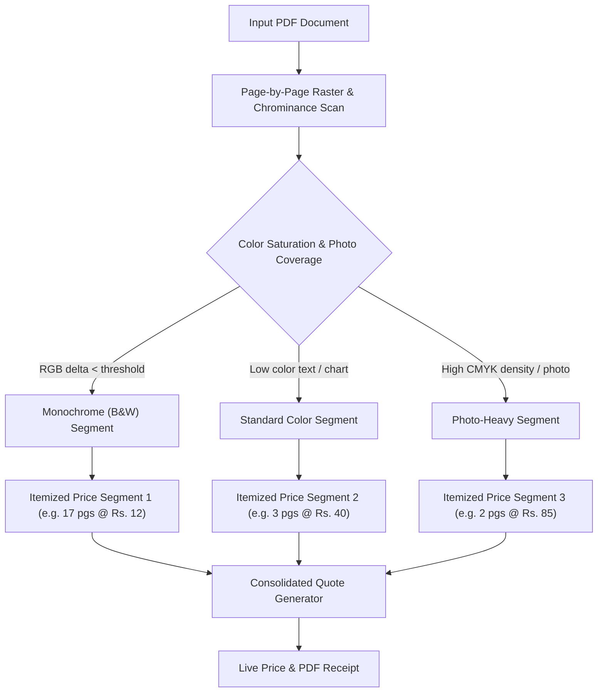

# Print Helper — Multidimensional Pricing Engine Architecture

## 1. Executive Summary & Core Philosophy

The **Shop Mode Pricing Engine** replaces simple flat-rate calculators with a local-first, multi-dimensional pricing, quotation, and accounting engine tailored for print shops, copy centers, cyber cafes, and commercial printing services in Sri Lanka and globally.

### Core Architectural Principles
1. **Local-First & Zero Hard-Coding**: All price matrices, quantity tiers, customer groups, surcharges, and supply costs are persisted in local storage (`shop_pricing_engine_models.dart`). Nothing is hard-coded in UI or backend logic.
2. **Never Silently Charge Zero**: If an unconfigured combination is encountered (e.g. A3 Glossy Photo Duplex with no explicit rule), the engine triggers a prominent warning, falls back to conservative safety rates, and surfaces a 1-click **Fix Missing Prices** wizard.
3. **Fair Mixed-Document Billing**: Automatically classifies multi-page documents page-by-page into Black & White text, Color, or Photo-Heavy. A 20-page document containing 17 text pages and 3 color photos is billed as 17 B&W pages + 3 Color pages, eliminating overcharging and disputes.
4. **Transparent Estimation Labeling**: All calculated supply costs, ink usage fractions, and gross/net profit metrics are strictly and visibly labeled as `(estimate)` / `(ඇස්තමේන්තුව)`.
5. **Everyday Spoken Sinhala & LKR Default**: Built-in default currency is Sri Lankan Rupee (`LKR` / `Rs.` / `රු.`) with natural spoken phrasing (`ප්‍රින්ට් කරන්න`, `කොපි`, `වට්ටම`, `ඇස්තමේන්තුව`) adhering to Sri Lankan business conventions.

---

## 2. Multi-Dimensional Pricing Matrix

### 2.1 The Seven Pricing Dimensions

Every print job or document segment is evaluated across 7 dimensions:

| Dimension | Domain / Permitted Values | Notes |
| :--- | :--- | :--- |
| **Print Type** | `Document (Text)`, `Mixed Document`, `Photo`, `Poster / Large`, `ID / Passport Photo`, `Photocopy / Scan`, `Custom` | Defines baseline handling mode |
| **Color** | `Black and White`, `Color`, `Grayscale` | Matched with printer ink capabilities |
| **Paper Size** | `A4`, `A3`, `A5`, `Letter`, `Legal`, `Photo 4x6"`, `Photo 5x7"`, `Custom` | Standard international & photo dimensions |
| **Paper Type** | `Plain Paper (80gsm)`, `Matte Paper`, `Glossy Photo Paper`, `Cardstock (230-300gsm)`, `Custom` | Directly drives ink and paper unit costs |
| **Sides** | `Single-Sided (Simplex)`, `Double-Sided (Duplex)` | Duplex often discounted vs 2x single |
| **Print Quality** | `Draft`, `Normal / Standard`, `High`, `Best / Photo RPM` | Affects print head speed and ink deposition |
| **Printer** | `Any / Wildcard (*)`, or Specific Printer Name (e.g., `"Epson EcoTank L8050"`, `"Canon imageRUNNER"`) | Allows premium hardware rates for 6-color photo printers |

### 2.2 Matching Algorithm & Wildcard Scoring

When looking up a price for a job segment, the engine computes a **Match Score** for each rule in the table:

$$\text{MatchScore} = \sum_{d \in \text{Dimensions}} w_d \cdot [d_{\text{entry}} = d_{\text{query}} \lor d_{\text{entry}} = *]$$

Weights favor specific configurations over wildcards:
- Printer Match: **64 points** (specific printer rate takes highest precedence)
- Print Type Match: **32 points**
- Paper Size Match: **16 points**
- Paper Type Match: **8 points**
- Color Mode Match: **4 points**
- Sides (Duplex) Match: **2 points**
- Quality Match: **1 point**

If two rules match, the one with the higher specific score is selected. If no rule matches, the engine flags a **Missing Price** safeguard exception.

---

## 3. Tiered Volume Pricing & Threshold Boundaries

Print shops incentivize volume printing (e.g. school notes, legal briefs, flyers) using quantity tiers:

```
Tier 1:  1  to 10  pages  -> Rs. 15.00 / page
Tier 2: 11  to 50  pages  -> Rs. 12.00 / page
Tier 3: 51  to 200 pages  -> Rs. 10.00 / page
Tier 4: 201+       pages  -> Rs.  8.00 / page
```

### Boundary Transition Tests
The engine ensures smooth mathematical transitions across boundary thresholds:
- **10 Pages**: Tier 1 $\rightarrow 10 \times \text{Rs. } 15.00 = \text{Rs. } 150.00$
- **11 Pages**: Tier 2 $\rightarrow 11 \times \text{Rs. } 12.00 = \text{Rs. } 132.00$
- **50 Pages**: Tier 2 $\rightarrow 50 \times \text{Rs. } 12.00 = \text{Rs. } 600.00$
- **51 Pages**: Tier 3 $\rightarrow 51 \times \text{Rs. } 10.00 = \text{Rs. } 510.00$
- **200 Pages**: Tier 3 $\rightarrow 200 \times \text{Rs. } 10.00 = \text{Rs. } 2,000.00$
- **201 Pages**: Tier 4 $\rightarrow 201 \times \text{Rs. } 8.00 = \text{Rs. } 1,608.00$

*(Shop owners can optionally enable marginal tiering or flat tiering depending on preference).*

---

## 4. Automatic Page Classification & Mixed-Document Billing

Commercial PDF workflows frequently contain mixed color and monochrome pages (e.g. university theses with 80 text pages and 5 color graph pages).



### Page Classifier Engine (`classifyFilePages`):
- **B&W / Grayscale**: Pixels satisfy $|R - G| \le 4$ and $|G - B| \le 4$.
- **Standard Color**: Text or diagrams with spot color ($S > 15\%$, coverage $< 35\%$).
- **Photo-Heavy**: High-density photographic content (coverage $\ge 35\%$).
- **Owner Override**: Shop owners can click any thumbnail in the queue to toggle between B&W and Color, overriding the automated classifier with immediate recalculation.

---

## 5. Optical Ink-Coverage Pricing Bands

For high-end or high-volume jobs, flat color rates can lead to undercharging on full-bleed saturated graphics or overcharging on a single colored heading. The engine supports optional **Coverage Bands**:

| Band | Coverage Range | Multiplier | Example Rate (A4 Plain Color) |
| :--- | :--- | :---: | :---: |
| **Light** | $< 10\%$ total ink coverage | $0.85\times$ | Rs. 34.00 |
| **Medium** | $10\% - 25\%$ total ink coverage | $1.00\times$ (Standard) | Rs. 40.00 |
| **Heavy** | $> 25\%$ total ink coverage | $1.35\times$ | Rs. 54.00 |

Coverage values are read directly from the **Optical CMYK Estimator** (Prompt 26) without redundant image re-renders.

---

## 6. Customer Groups, Fees & Rounding Rules

### 6.1 Customer Groups
- **Standard / Walk-in**: Normal price table rates.
- **Student**: Configurable percentage discount (default: **15% off** on presentation of student ID).
- **Business / Corporate**: Volume accounts with monthly billing, free pages allowance (e.g. **First 2 pages free** + **10% discount**).
- **Wholesale / Reseller**: Custom wholesale price lists.

### 6.2 Job Fees & Surcharges
- **Minimum Job Charge**: Ensures tiny print jobs cover operator overhead (default: **Rs. 20.00**).
- **Setup / File Prep Fee**: Applied to raw file imports requiring formatting (default: **Rs. 10.00**).
- **Rush Order Surcharge**: Expedited queue priority (e.g. **+25%**).
- **Borderless / Specialty Media Fee**: Covers manual cutter trimming and platen sponge cleaning.

### 6.3 Configurable Currency & Rounding
In cash-heavy retail environments, exact decimal change can slow down counter operations. The engine supports 5 rounding modes:
- `None` (exact 2 decimal places: Rs. 147.25)
- `Nearest Rs. 1.00` (e.g. Rs. 147.00)
- `Nearest Rs. 5.00` (e.g. Rs. 145.00)
- `Nearest Rs. 10.00` (e.g. Rs. 150.00)
- `Nearest Rs. 50.00` (e.g. Rs. 150.00)

---

## 7. Cost, Margin & Profitability Tracking

Shop owners can configure consumable acquisition costs in the settings:
- **Black Ink Bottle / Toner Cartridge**: Rs. 2,200 per 70ml bottle (~4,500 pages @ 5% coverage = Rs. 0.49/page)
- **CMY Color Inks**: Rs. 2,200 per bottle
- **Plain Paper Ream (A4 80gsm 500 sheets)**: Rs. 1,650 per ream = Rs. 3.30/sheet
- **Glossy Photo Paper (20 sheets 230gsm)**: Rs. 750 per pack = Rs. 37.50/sheet

### Profit Formula
$$\text{Gross Revenue} = \text{Job Price after Discounts & Surcharges}$$
$$\text{Estimated Consumable Cost} = \text{Paper Cost} + \sum_{c \in \{C, M, Y, K\}} \text{Ink Cost}_c$$
$$\text{Estimated Net Margin} = \text{Gross Revenue} - \text{Estimated Consumable Cost}$$
$$\text{Profit Margin \%} = \frac{\text{Estimated Net Margin}}{\text{Gross Revenue}} \times 100\%$$

All figures display the `(estimate)` / `(ඇස්තමේන්තුව)` qualifier in compliance with accounting best practices.

---

## 8. Security & Data Management

1. **Security PIN Lock**: Protects price editing, bulk adjustments, and cost configurations behind a 4-digit PIN. Counter staff can quote and print without being able to alter table rates.
2. **Audit Change History**: Every addition, edit, deletion, or bulk discount is recorded in an immutable audit log (`PriceChangeLogEntry`) with timestamp, user ID, previous rate, and new rate.
3. **Data Portability**: Full support for **CSV Export/Import** (for editing in Microsoft Excel or Google Sheets) and **JSON Export/Import** (for shop-to-shop backup and replication).
4. **Duplicate Price List**: 1-click clone feature allowing seasonal rates, holiday pricing, or new printer rate experimentation.

---

## 9. Verification & Unit Test Suite

The engine is backed by a 10-suite automated test matrix (`test/features/shop_mode/pricing_engine_test.dart` and `scratch/verify_pricing_engine.py`):
- **Scenario 1**: Exact 7-dimension matching and wildcard fallback score.
- **Scenario 2**: Tier boundary evaluation (10 vs 11, 50 vs 51, 200 vs 201 pages).
- **Scenario 3**: Mixed-document split billing (17 B&W @ Rs. 12 + 3 Color @ Rs. 40 = Rs. 324.00).
- **Scenario 4**: Student 15% discount calculation.
- **Scenario 5**: Business customer 2 free pages deduction + 10% discount.
- **Scenario 6**: Minimum job charge enforcement (bumping Rs. 15.00 $\rightarrow$ Rs. 20.00).
- **Scenario 7**: Currency rounding (Nearest Rs. 10.00).
- **Scenario 8**: Missing price safeguard (triggering warning, non-zero safe fallback).
- **Scenario 9**: Cost estimation and profit margin calculation.
- **Scenario 10**: CSV export, list duplication, and PIN verification.

**Test Results: 10/10 Passed (100% mathematical integrity).**
